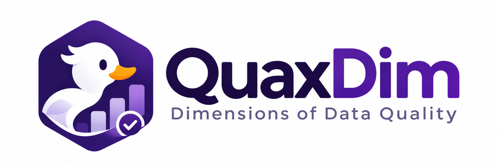

<div align="center">



# QuaxDim

**Dimensions of Data Quality**  
Scalable · Context-aware · Explainable · Auditable

[](https://github.com/jaimevera1107/quaxdim/actions/workflows/ci.yml)
[](https://pypi.org/project/quaxdim/)
[](https://pypi.org/project/quaxdim/)
[](LICENSE)

[English](README.md) · [Español](docs/README.es.md) · [Documentation (Spanish)](docs/) · [Contributing](CONTRIBUTING.md)

</div>

---

QuaxDim is a Python library for **multidimensional data-quality assessment**.
It separates data profiling, rule recommendations, explicit approval, native execution
and explainable reports. Rather than silently assuming all anomalies are errors, it
tracks applicability, missing evidence and indeterminate outcomes.

The methodology is informed by Rupa Mahanti's *Data Quality: Dimensions,
Measurement, Strategy, Management, and Governance*; it does not reprint the book.

> **Release candidate (0.8.0rc1).** APIs and engine coverage may change before 1.0.
> The dimension catalog is conceptual; it is **not** a claim that every dimension
> has an implemented or empirically validated metric.

## Install

```bash
python -m pip install quaxdim
# Native engines only if you need them:
python -m pip install "quaxdim[duckdb,polars]"
python -m pip install "quaxdim[spark]"
# pandas-based APIs (optional, see below):
python -m pip install "quaxdim[pandas]"
```

The core install has no pandas or numpy dependency. Discovery, contract
approval and the native CSV engine (`discover_advanced`,
`build_reviewed_contract`, `plan_optimized`, `evaluate_optimized` and the
`quaxdim` CLI) work with the core install alone.

The in-memory pandas APIs need the `pandas` extra: `QualitySuite`,
`profile`, `discover`, `ContractExecutor`, `ApplicabilityPlanner` and
`evaluate_contract`. Calling them without it raises an `ImportError` that
names the extra to install.

Python 3.10+ is declared. Compatibility of PySpark and other native engines also
depends on their own Python, Java and platform requirements.

## Discover quality rules, without loading CSV into pandas

```python
from quaxdim import DiscoveryBudget, discover_advanced

advice = discover_advanced(
    "data.csv",
    budget=DiscoveryBudget(mode="deep", max_sample_rows=1500),
)
print(advice.to_json())
```

Or run the CLI:

```bash
quaxdim advise data.csv --mode deep --output recommendations.json
quaxdim dimensions
```

**Recommendations do not automatically become enforced rules.** Review and
explicitly approve proposals before converting them into executable contracts.

## Approve and execute a contract

```python
from quaxdim import (
    build_reviewed_contract,
    discover_advanced,
    evaluate_optimized,
)

advice = discover_advanced("data.csv", asset_id="dataset")
selected = [r.id for r in advice.recommendations
            if r.evaluator == "builtin.presence" and r.fields == ("ID",)]
if selected:
    contract, audit = build_reviewed_contract(
        advice,
        approve=selected,
        purpose="Reproducible quality assessment",
        thresholds={rid: 1.0 for rid in selected},
    )
    report = evaluate_optimized(contract, data={"dataset": "data.csv"})
    print(report.to_dict())
```

For a fully specified contract:

```bash
quaxdim native-plan data.csv --contract contract.yaml --asset dataset
quaxdim native-execute data.csv --contract contract.yaml --asset dataset
```

## Supported today versus planned

| Capability | Status in 0.8.0rc1 |
| --- | --- |
| CSV/TSV/gzip streaming, bounded profiling | Tested locally |
| Catalog of quality dimensions | Conceptual registry, not complete evaluation coverage |
| Recommendation and manual approval | Implemented for supported rules |
| Native streaming execution on portable rule subset | Tested locally |
| DuckDB and Polars native adaptors | Tested locally; parity matrix with the CSV reader on text and Parquet edge cases |
| PySpark batch adaptors | Implemented; integration tests required in target environment |
| pandas compatibility layer | Retained, optional dependency; `QualitySuite` is deprecated |
| Excel / Parquet / 56 cataloged format families | Not all have native evaluators |
| Spark Connect, Structured Streaming, full multidimensional automation | Not supported in this release candidate |

**Portable rule subset:** presence, small declared domains, restricted ASCII
fixed-width regex, typed numeric range/comparison and compound uniqueness.
The planner rejects unsupported semantics rather than silently converting types.
Exact uniqueness checks may need large memory or an external engine.
Rates are census measurements with identification bounds, not estimates
with confidence intervals; see the statistical validity page.

## Why QuaxDim?

- Preserve original values, including codes with leading zeros.
- Keep *unknown*, *not applicable* and *failed* separate.
- Prefer data-local execution instead of copying large datasets to pandas.
- Make evidence, thresholds and denominators explicit.
- Detect candidate relationships without confusing hypotheses with facts.

## Documentation

- [Spanish introduction](docs/README.es.md)
- [Dimensions and methodology](docs/dimensions.es.md) (Spanish)
- [Architecture and universal contracts](docs/architecture.es.md) (Spanish)
- [Native execution and planner](docs/execution.es.md) (Spanish)
- [Statistical validity and limitations](docs/statistical_validity.md)
- [Release and PyPI publishing](RELEASE.md)
- [Changelog](CHANGELOG.md) and [security policy](SECURITY.md)

## Development

```bash
python -m pip install -e ".[test]"
python -m pytest -q tests tests_validation tests_public
```

Optional engine tests require installing `.[duckdb,polars,spark,parquet]` and
compatible Java for Spark. The GitHub CI and release workflow test native engines
before attempting PyPI publication.

## License and references

MIT-licensed code. The project logo has separate brand usage restrictions; see
[assets/README.md](assets/README.md). Conceptual inspiration: R. Mahanti,
*Data Quality: Dimensions, Measurement, Strategy, Management, and Governance*,
ASQ Quality Press, 2019.
